# Sikh AI — Android screenshots

Screens from the Sikh AI Android app ([Google Play](https://play.google.com/store/apps/details?id=com.anhadapp)).

| | | |
|---|---|---|
| 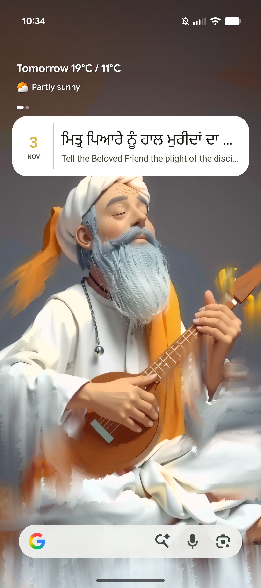 Home screen widget |  Daily |  Full Hukamnama |
| 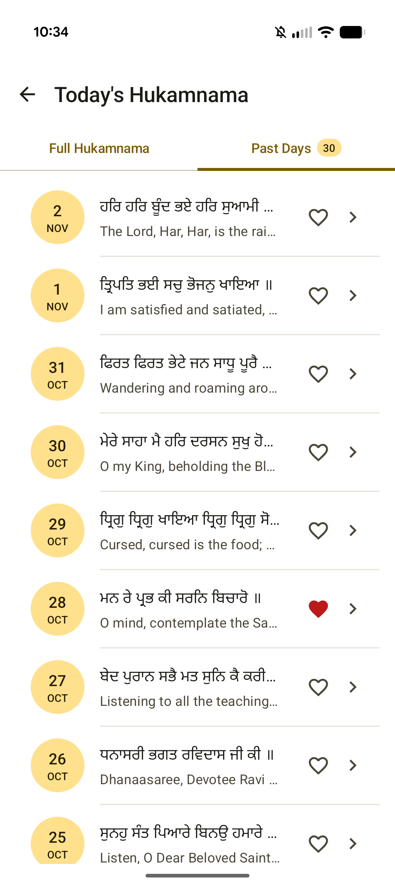 Past Hukamnamas | 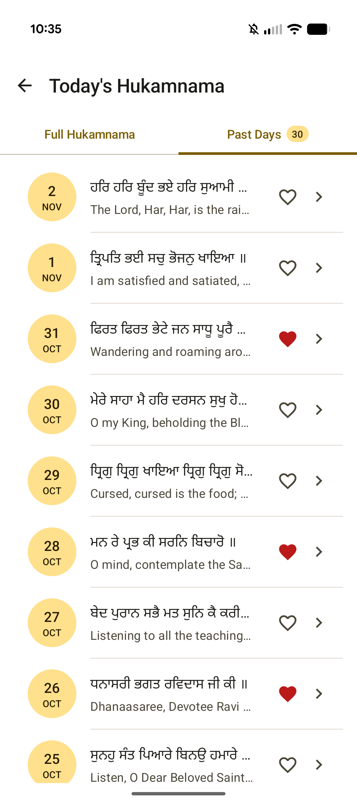 Past Hukamnamas (favourites) | 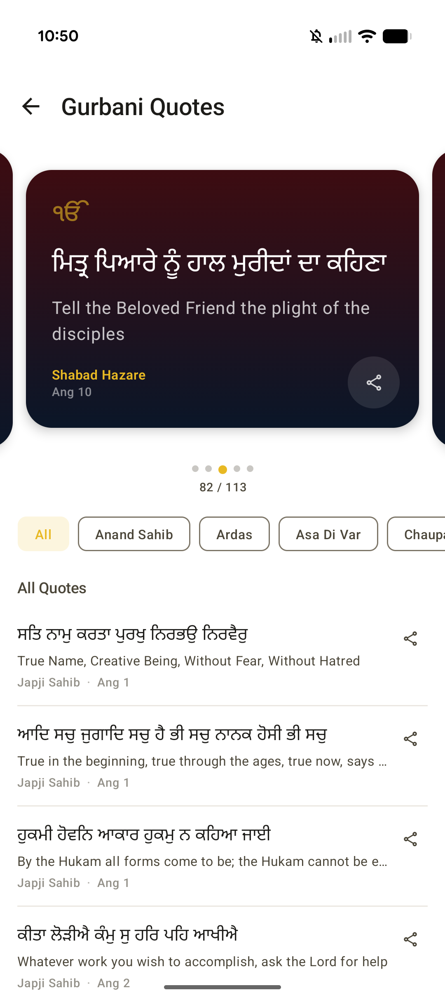 Gurbani Quotes |
| 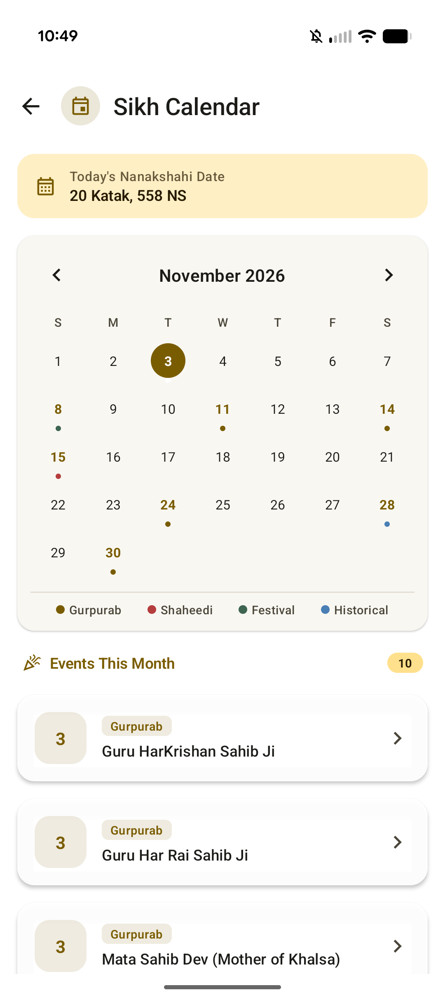 Sikh Calendar | 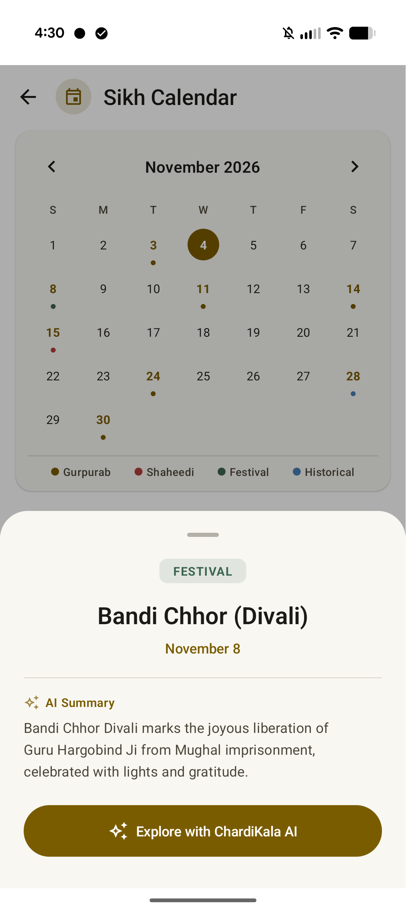 Calendar event with AI summary | 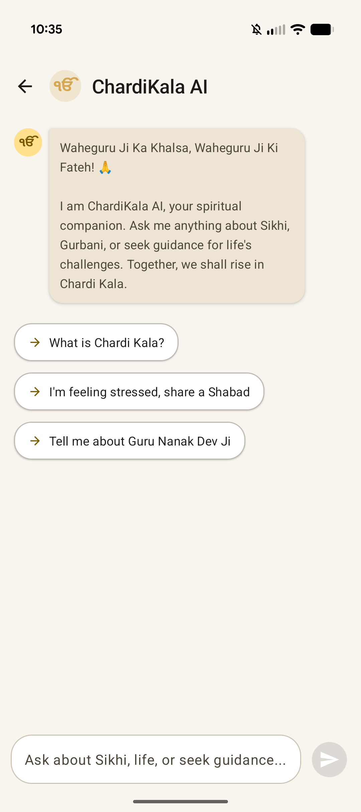 ChardiKala AI |
| 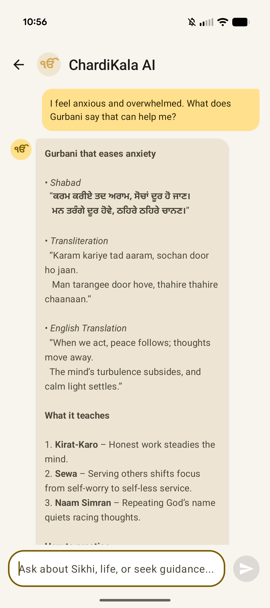 ChardiKala AI answer | 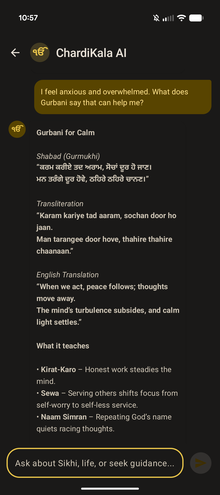 ChardiKala AI answer (dark) | 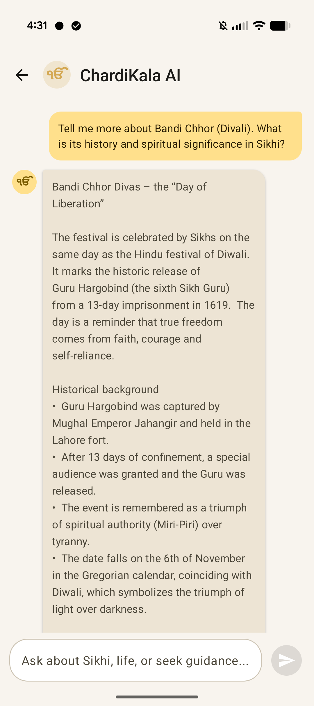 ChardiKala AI on Bandi Chhor Divas |
| 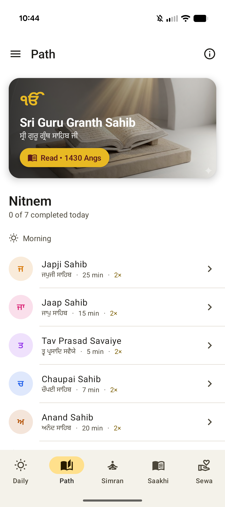 Path |  Path (dark) |  Path progress (dark) |
| 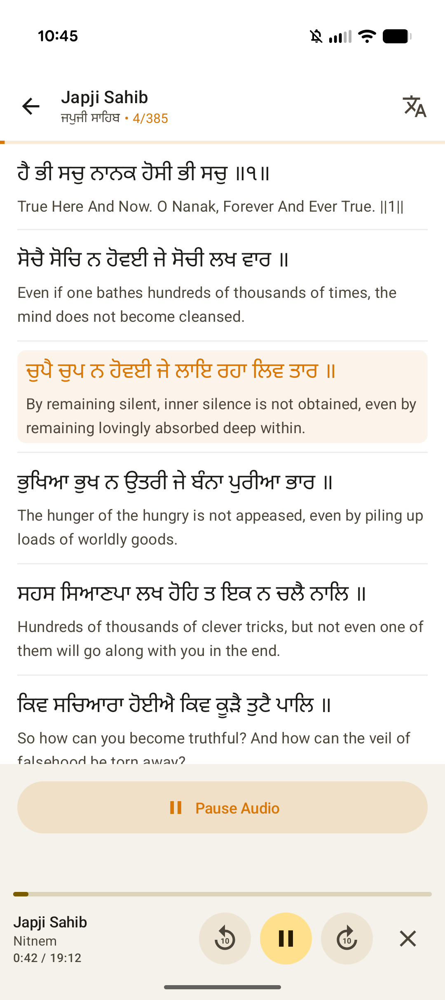 Japji Sahib reader | 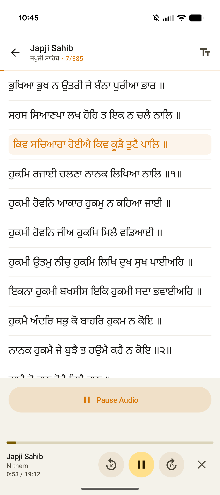 Line-synced highlighting |  Audio scrubbing |
| 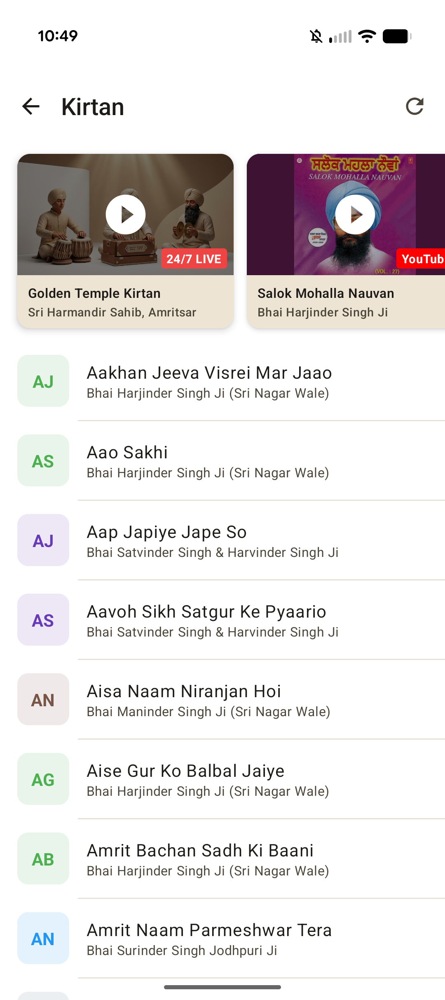 Kirtan | 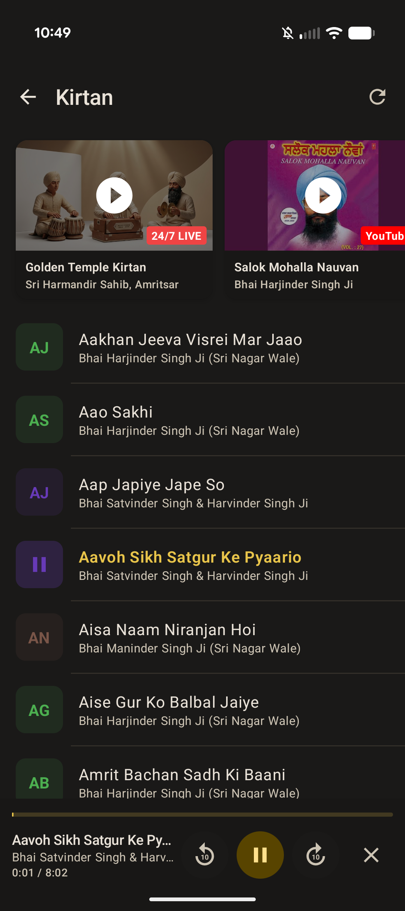 Kirtan playing (dark) |  Live Kirtan |
|  Naam Simran | 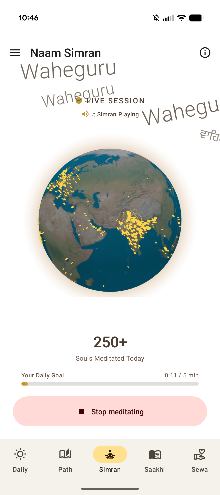 Simran live session | 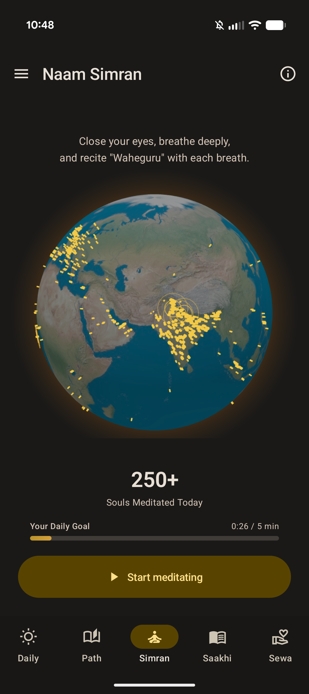 Naam Simran (dark) |
| 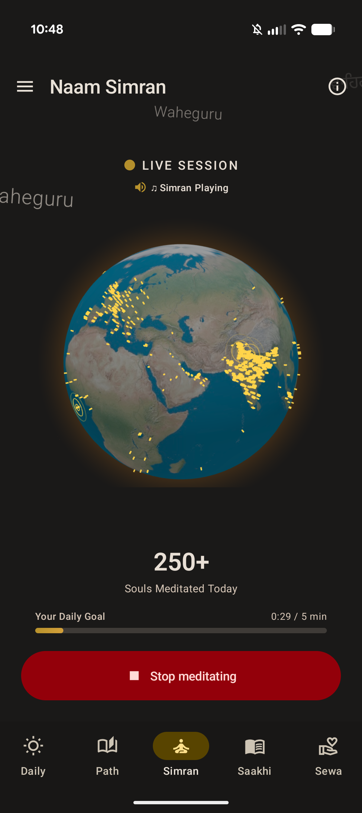 Simran live session (dark) | 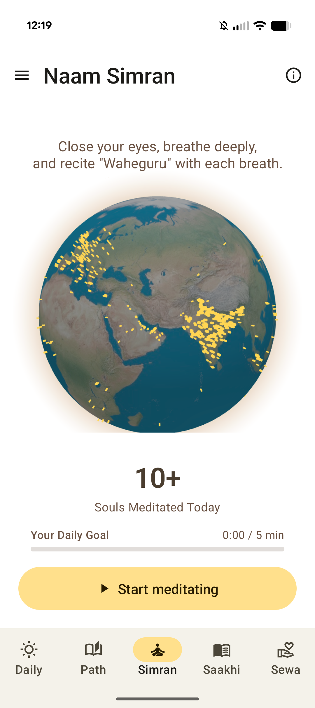 Naam Simran globe |  Naam Simran globe 2 |
|  Naam Simran (Hindi) |  Naam Simran (Punjabi) |  Simran daily goal |
| 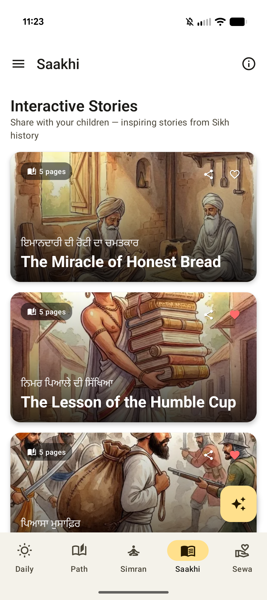 Saakhi |  Saakhi (dark) |  Story page |
|  Moral of the story |  Sewa Pulse |  Sewa Pulse news |
|  Sewa news | 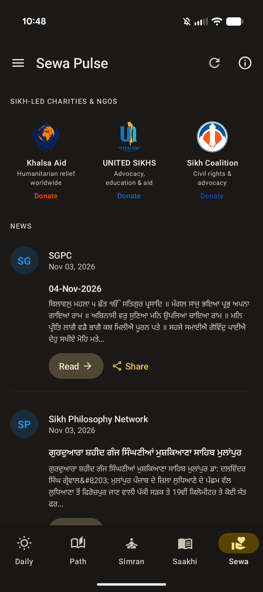 Sewa Pulse (dark) |  My Journey |
|  Settings |  Favourites |
